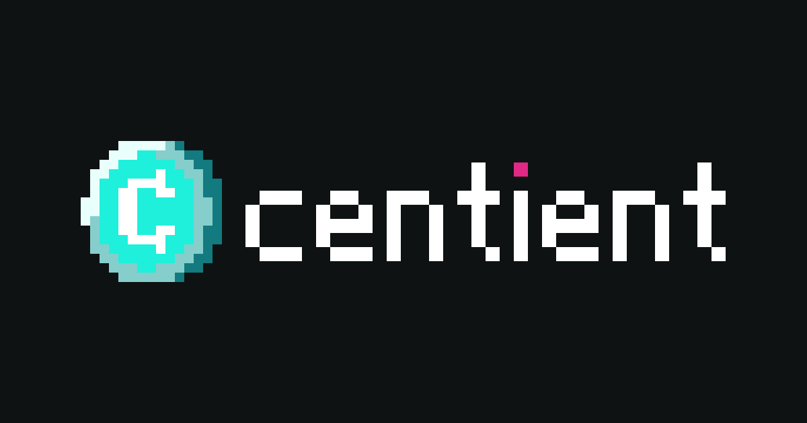

<h1 align="center"></h1>

Centient: a private balance tracker on Cloudflare Workers + D1, with a React web app you can install to your phone's Home Screen.

## Run locally

```sh
npm install
cp apps/centient/.dev.vars.example apps/centient/.dev.vars   # first time only

npm run dev                      # local D1 migrations, then the Worker + app on http://localhost:8787 with live reload
npm test                         # money, quick-add, ledger, D1 and HTTP tests (vitest)
npm run typecheck                # Worker and app
npm run e2e                      # end-to-end (Playwright): its own server on :8790 with fresh data, never your dev data
npm run build -w apps/centient   # production build into apps/centient/dist/
```

- `npm run dev` runs everything in one process: Cloudflare's Vite plugin runs the Worker in workerd next to the React app, so `/api/*` and the UI share one origin.
- To try the production build locally: `cd apps/centient && npx vite preview`.
- Locally you are signed in as `DEV_EMAIL` from `.dev.vars`. That bypass only works on localhost, private LAN addresses and `DEV_HOSTS`; in production every request needs a valid Cloudflare Access JWT.
- Fresh local data: delete `apps/centient/.wrangler/` and run `npm run dev` again.
- `/preview` shows the design kit (colors, type, every component).

## Layout

- `packages/money` - amount parsing (25rb, 1,5jt, Rp52.500, $20, 0.001 btc) and formatting
- `packages/quickadd` - quick-add parser: abbreviations, Hokkien words, price-range context engine, currencies
- `apps/centient/src/domain` - ledger rules and budget cycles (no I/O)
- `apps/centient/src/application` - use cases and ports
- `apps/centient/src/infrastructure` - D1 repositories
- `apps/centient/src/interface` - Hono routes (typed for the client), Zod validation, Access auth
- `apps/centient/migrations` - D1 schema (0001 init, 0002 entry groups)
- `apps/centient/client` - React + Konsta UI + Vite app: Home (log + activity), Money (accounts, Pockets, budgets), Settings; Geist font, Phosphor icons, manifest and icons

## Deployment

1. `npx wrangler d1 create centsdb` and put the id in `apps/centient/wrangler.toml` (the Worker is named `cts`). Create the file bucket for proof of payment: `npx wrangler r2 bucket create centient-files`.
2. Protect the hostname with Cloudflare Access; set `ACCESS_TEAM_DOMAIN`, `ACCESS_AUD`, `SERVICE_TOKEN_EMAIL`.
3. `npm run deploy -w apps/centient` (remote migrations, build, deploy).

## Test on a phone

- Same Wi-Fi: run `npm run dev`, then open `http://<your Mac's address from ipconfig getifaddr en0>:8787`. Use Share > Add to Home Screen to install it.
- From anywhere, with ngrok:
  create `apps/centient/ngrok.policy.yml` (Google sign-in, your email only), run
  `ngrok http 8787 --traffic-policy-file ngrok.policy.yml`, set `DEV_HOSTS=<your ngrok host>` in
  `apps/centient/.dev.vars`, then `npm run dev`. Never run the tunnel without the policy file.
  If the page says the host is not allowed, the dev server is blocking the ngrok hostname: add it to `server.allowedHosts` in `apps/centient/vite.config.ts`.
